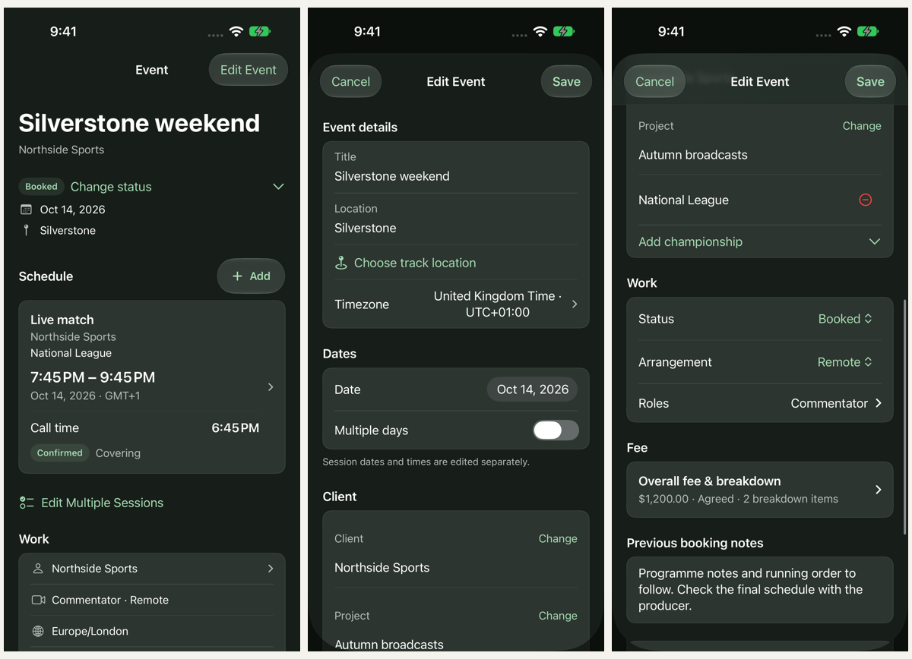

# Single-client events verification

October 14, 2026. Native SwiftUI implementation; synthetic fixture data.

## Result

Each event has one client, one schedule and its own fees/payments. Event details
use the full existing detail surface. The single editor exposes Client, Work and
Fee directly, with no booking accordion, add-client action or linking controls.
The guided creation wizard and adaptive Schedule/Coverage controls remain.

Historical grouped records appear independently. Editing their event metadata
copies it into an owned event record, preserving client, session and financial
history without changing other former group members. This also covers partially
downloaded groups. Retained historical event IDs allow Calendar reconciliation
to remove obsolete grouped placeholders. No schema migration is required.

## Validation

- Final model run: 45 tests, 44 passed and Calendar integration skipped because
  permission was unavailable. The skipped integration test was then run with
  simulator Calendar permission and passed: all 45 model tests verified.
- Persistence coverage includes single-client enforcement, atomic failure,
  historical group isolation, partial downloads, reopen, retained financial
  history, session ownership and migration.
- The broader iPhone UI run passed all 15 selected tests, including all 11 wizard
  tests, date/discard, repeated sessions/bulk editing, direct fees and visuals.
- Final iPhone UI run passed invoice/partial-payment, direct-fee/no-grouping and
  visual tests. Final iPad visual run passed light, dark and accessibility XL.
- Calendar reconciliation and single-publisher integration passed.
- `git diff --check` passed.

The first model run exposed an unwanted “Client to add” suffix in calendar titles
for events without a client; this was corrected and the final model run passed.
Physical-device iCloud convergence was not exercised. Older app builds retain
their former grouping behavior; devices should upgrade together.

Local test bundles (temporary, not committed):

- `/tmp/cuekeeper-single-tests.xcresult` — initial broader UI run; includes the
  superseded calendar title failure described above.
- `/tmp/cuekeeper-single-final.xcresult` — final model and iPhone checks.
- `/tmp/cuekeeper-single-ipad-final.xcresult` — final iPad visual checks.
- `/tmp/cuekeeper-single-calendar.xcresult` — passing Calendar integration.

## Screenshots

`implementation-board.png` combines final native iPhone captures of the overview,
editor and scrolled client/work/fee fields. Individual screenshots include iPhone
and iPad light/dark appearances, accessibility XL, and wizard entry. Fixture routes
open screens directly, so they omit the normal tab shell. iPad captures were
rotated to their displayed orientation; the board resizes captures only.

